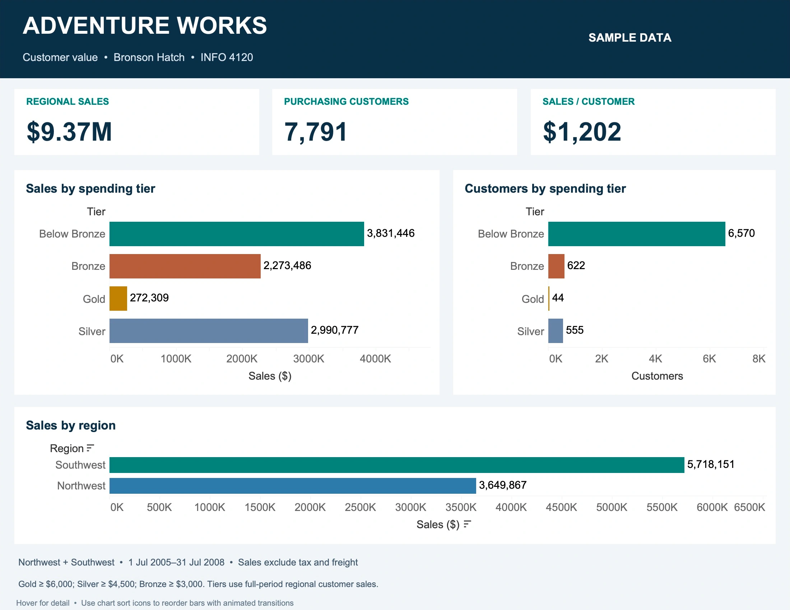

# Adventure Works customer analytics

Tableau coursework comparing customer spending with each segment's contribution to sales.

I built two views for INFO 4120: customer spending tiers and customer segment composition. Keeping buyer counts beside sales makes it easier to distinguish a high-spending customer from a large group that contributes more overall.

## Read the result

The Northwest and Southwest sample covers July 1, 2005–July 31, 2008: $9,368,017.36 in sales across 7,791 purchasing customers. Sales exclude tax and freight. Gold contains 44 buyers; the much larger Below Bronze group contributes more total sales. Married professionals account for 20.7% of customers and 18.8% of sales in this regional sample.

These are descriptive sample results, not campaign performance or a business impact claim.

## What I built

Excel source tables → Tableau relationships → customer-level sales calculations → spending tiers and segment dashboards.

The regional calculation is retained in [selected-calculations.txt](selected-calculations.txt). It aggregates sales at customer level before assigning a tier. Gold starts at $6,000, Silver at $4,500, and Bronze at $3,000 in full-period regional customer sales.

## Open and review

Start with the image above and [segment dashboard](media/segment-profile.webp). Both are saved exports, so hovering and sorting do not run inside GitHub. The [portfolio](https://bronsonhatch.com) provides the wider project presentation.

The original Tableau workbook and source spreadsheet are maintained privately. This curated repository has no build or installation step and does not include instructor materials or row-level customer data.

## Verification and limits

Saved September 2026 verification reconciles source keys, regional sales, customer counts, tier totals, and segment totals with independent SQL calculations. The September 29 presentation check records two dashboards opened in Tableau, unchanged formulas/filters, and a sort/undo review. Those are historical checks, not a fresh Tableau run performed for this repository.

[Use and attribution](USE-AND-ATTRIBUTION.md). Adventure Works is sample business data; this is student work and is not affiliated with Microsoft.
