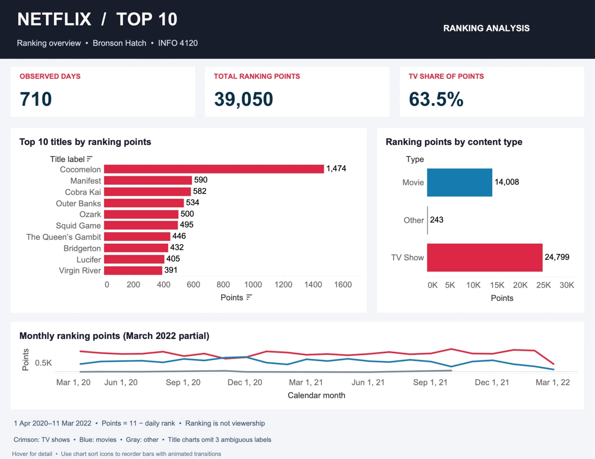

# Tableau Analytics Showcase

Two Tableau case studies about choosing the right comparison: how much a customer spends versus what a whole segment contributes, and how high a title ranks versus how long it stays in the chart.

I built these projects for INFO 4120 using Excel source data and Tableau. Each folder contains the project write-up, saved dashboard views, selected calculations, and attribution.

## Explore the projects

| Project | Question | A result to examine |
| --- | --- | --- |
| [Adventure Works customer analytics](tableau/adventure-works/) | Do the highest-spending customers also contribute the most total sales? | The Gold tier has 44 buyers; the larger Below Bronze group contributes more sales overall. |
| [Netflix Top 10 rankings](tableau/netflix-rankings/) | Which titles peak in the rankings, and which stay there? | Cocomelon appears on 428 observed days and earns 1,474 ranking points. |

## Adventure Works: individual value and segment size

The regional sample covers Northwest and Southwest sales from July 1, 2005 through July 31, 2008: $9.37 million across 7,791 purchasing customers, excluding tax and freight. I totaled sales at customer level before assigning spending tiers, then compared each segment's share of customers with its share of sales.

Married professionals account for 20.7% of customers and 18.8% of sales in this sample. Keeping both denominators visible makes the segment easier to interpret.

[Read the case study](tableau/adventure-works/) · [View the segment dashboard](tableau/adventure-works/media/segment-profile.webp) · [Inspect the calculation](tableau/adventure-works/selected-calculations.txt)

## Netflix: ranking strength and persistence

The supplied observations run from April 1, 2020 through March 11, 2022. I assigned ten points to first place and one to tenth using `11 - [Rank]`, then compared accumulated points with observed days in the Top 10.

Squid Game earns 495 points across 66 observed days; Lucifer earns 405 across 56. The two measures describe different aspects of a title's chart presence. They do not measure viewers or hours watched.

[Read the case study](tableau/netflix-rankings/) · [View title persistence](tableau/netflix-rankings/media/title-persistence.webp) · [Inspect the calculation](tableau/netflix-rankings/selected-calculations.txt)

## Reviewing the work

Start with either case study, compare its two dashboard views, and follow the selected calculation. The images are saved Tableau exports; GitHub does not provide their hover or sorting interactions. There is no installation step.

The project write-ups explain the source periods, definitions, exclusions, and saved September 2026 verification. Adventure Works uses sample business data. Netflix describes ranking observations, with a partial final month and three ambiguous title labels excluded from title comparisons. These are historical coursework analyses; they do not establish campaign results or commercial impact.

The original workbooks and source spreadsheets are maintained privately. Instructor materials and row-level source datasets are not included. Existing project assets and write-ups are preserved in their folders, with [Adventure Works attribution](tableau/adventure-works/USE-AND-ATTRIBUTION.md) and [Netflix attribution](tableau/netflix-rankings/USE-AND-ATTRIBUTION.md).

[More of my work](https://bronsonhatch.com)
